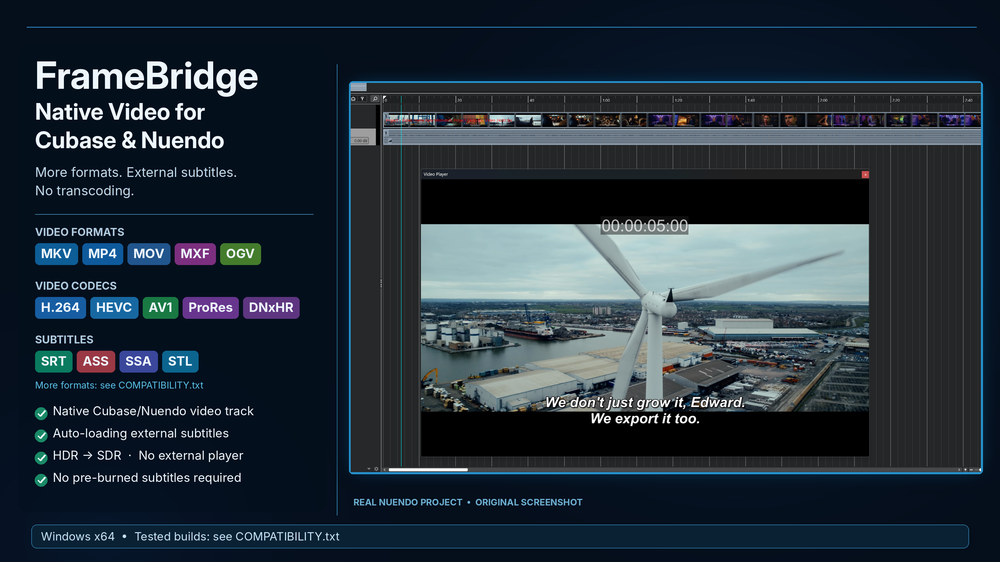

# FrameBridge — Native Video & External Subtitles for Cubase & Nuendo

**Website: [framebridge.cc](https://framebridge.cc)** · [Watch the FrameBridge demonstration on YouTube](https://youtu.be/NjNHtkc8-OE)

FrameBridge extends the native video engine of Windows x64 Cubase and Nuendo. Modern video formats open on the native video track and play in the built-in Video Player, and external subtitle files are shown over the picture automatically — without transcoding the media and without burning subtitles into the video.

## Key benefits

- Works with the native Cubase/Nuendo video track and built-in Video Player.
- Extended container and codec support through packaged FFmpeg libraries (LGPL).
- External subtitle sidecars are loaded automatically and shown over the picture; edits to the subtitle file are picked up live. The video file itself is never changed.
- Every subtitle format is drawn in one clean look (the SRT look). Blu-ray PGS/SUP and DVD VobSub pictures are read as text with the Windows built-in OCR.
- No separate video player, codec pack or LAV Filters required.
- Visually verified HDR-to-SDR conversion for supported HDR media. No quantitative color-accuracy claim is made.

## Supported Cubase and Nuendo versions

**Verified builds**

- **Cubase:** 8.0.10 and 9.0.0 (LE AI Elements), 10.5.0.68, 11, 12.0.10 / 12.0.51 / 12.0.52, 13.0.21, 14.0.5 / 14.0.10 / 14.0.20 / 14.0.32 / 14.0.40, 15.0.5 / 15.0.21 / 15.0.30
- **Nuendo:** 10, 12.0.52, 13.0.10 / 13.0.50, 14.0.32 / 14.0.40, 15.0.21 / 15.0.30

**Nearby builds very likely work.** The video engine barely changes within one product generation, so if, for example, Nuendo 12.0.52 is verified, 12.0.20 or 12.0.70 will very likely work too. The installer checks the video engine of each installation itself: a compatible one is offered for installation, an incompatible one is not listed and nothing is changed. This is not a guarantee. Older editions with the same engine generation (for example Nuendo 7–9, Cubase 8.5 / 9.5) may also qualify but have not been tested.

On Cubase 8 and 9, FrameBridge also supplies the audio of the files it opens (for example MKV), so "Extract audio from video" works for them as in newer versions.

Cubase Pro, Artist, Elements, AI and LE editions are found the same way. See [COMPATIBILITY.txt](COMPATIBILITY.txt) for the full matrix.

## Verified media support

**Containers:** MKV / WebM, FLV, M2TS / MTS / TS, MOV / MP4, AVI, MXF, MPEG-PS / VOB, and OGV.

**Video codecs and profiles:** APV, AV1 8-bit, AV1 10-bit, CineForm, DNxHR, FFV1, H.264 Main / High10 / B-frames / VFR, HEVC Main10, HuffYUV, MPEG-2, ProRes 422 HQ, ProRes 4444, Theora, UtVideo, VP8, VP9 10-bit, and Xvid.

**External subtitles:** SRT, ASS, SSA, VTT, SMI / SAMI, MicroDVD, TTML, DFXP, IMSC, EBU STL, SCC, DCP XML, PGS / SUP, and VobSub (the .idx + .sub pair). Put the subtitle file next to the video with the same name (for example `film.mkv` + `film.srt`).

PGS/SUP and VobSub text recognition uses the OCR languages installed in Windows (usually the system language and English; more can be added in Windows settings). Without the needed language the original subtitle pictures are shown.

VVC/H.266 is intentionally unsupported in this beta.

## Installation and rollback

- Close Cubase and Nuendo and run `INSTALL.cmd`. Registered installations are found automatically; otherwise pick the program's EXE or folder.
- `UNINSTALL.cmd` restores the original program files from a verified backup (byte for byte). Projects, preferences and plug-ins are not touched.
- No Steinberg file is shipped in the package; the installer works only with the files of your own installation.

Full instructions are in [READ_ME_FIRST.txt](READ_ME_FIRST.txt) and [README.txt](README.txt).

## Release file check

- Current release: `FrameBridge Native Video and Subtitles for Cubase and Nuendo Beta.zip`
- SHA-256: `c804d914c86e2abe7f05476455ae8efb447c6f2a74220bef515af9d266709e50`
- [VirusTotal report](https://www.virustotal.com/gui/file/c804d914c86e2abe7f05476455ae8efb447c6f2a74220bef515af9d266709e50/detection): 1/63 — a single generic heuristic from one engine (MaxSecure); Microsoft Defender, Kaspersky, BitDefender, ESET, Malwarebytes, Sophos, Symantec and the other completed engines report no detection.

## Performance

Playback speed depends on the media and the hardware. Heavy 4K 10-bit video (HEVC Main10, H.264 High10) needs a capable CPU/GPU: on an older test PC (Intel Core i5-2550K + GeForce GTX 660) it stuttered heavily, because a GPU of that generation cannot decode these formats in hardware. On weak PCs, switching off video thumbnails in the DAW and using H.264 8-bit working copies up to 1080p is recommended. Known issues are listed in [READ_ME_FIRST.txt](READ_ME_FIRST.txt).

## Platform and status

- Windows x64
- FrameBridge Beta
- Commercial, proprietary software

**[Buy FrameBridge](https://www.creem.io/payment/prod_vhrQNgibUBvDcUt13M0f1)** · Website: [framebridge.cc](https://framebridge.cc)

**Pricing:** Pay what you want — 29 USD minimum,  
59 USD suggested. One-time purchase.

**Support:** stark622@ukr.net

**Legal:**

- [Privacy Policy](PRIVACY_POLICY.md)
- [Terms of Service](TERMS_OF_SERVICE.md)
- [End-User License](END_USER_LICENSE.txt)

## Licensing

FrameBridge is commercial software. The proprietary product terms are provided in [END_USER_LICENSE.txt](END_USER_LICENSE.txt). Third-party licensing details, including the terms applicable to the packaged FFmpeg shared libraries (LGPL 2.1 or later, source included in the package), are provided in [LICENSE_AND_NOTICE.txt](LICENSE_AND_NOTICE.txt).

FrameBridge is independent software and is not affiliated with, sponsored by, or endorsed by Steinberg. Cubase and Nuendo are trademarks of their respective owner.
