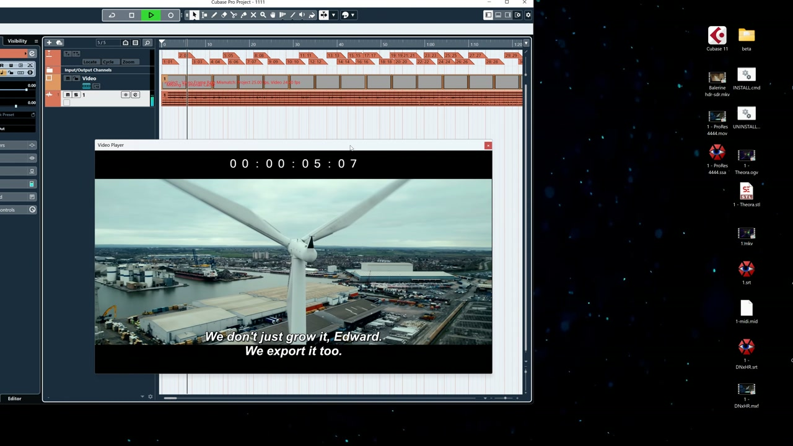

# FrameBridge — Native Video for Cubase & Nuendo

*Click the preview to play the full demonstration.*

FrameBridge extends the native video engine in selected Windows x64 versions of Cubase and Nuendo. It enables a broader range of supported video formats and automatically loads supported external subtitle sidecars, without preliminary transcoding of supported media.

## Key benefits

- Works with the native Cubase/Nuendo video track and built-in Video Player.
- Adds extended container and codec support through packaged FFmpeg libraries.
- Automatically loads and renders supported external subtitle sidecars.
- Uses supported media without preliminary transcoding.
- Requires no separate external video player or codec pack.
- Does not require subtitles to be burned into the source video in advance.
- Includes visually verified HDR-to-SDR conversion for supported HDR media. No quantitative color-accuracy claim is made.

## Verified media support

**Containers:** MKV / WebM, FLV, M2TS / MTS / TS, MOV / MP4, AVI, MXF, MPEG-PS / VOB, and OGV.

**Video codecs and profiles:** APV, AV1 8-bit, AV1 10-bit, CineForm, DNxHR, FFV1, H.264 Main / High10 / B-frames / VFR, HEVC Main10, HuffYUV, MPEG-2, ProRes 422 HQ, ProRes 4444, Theora, UtVideo, VP8, VP9 10-bit, and Xvid.

**External subtitles:** SRT, ASS, SSA, VTT, SMI / SAMI, MicroDVD, TTML, DFXP, IMSC, EBU STL, SCC, DCP XML, PGS / SUP, and VobSub.

VVC/H.266 is intentionally unsupported in this beta. See [COMPATIBILITY.txt](COMPATIBILITY.txt) for the complete verified matrix, performance notes, and known limitations.

## Supported Cubase and Nuendo versions

FrameBridge has been tested only on the specific Cubase and Nuendo builds listed in [COMPATIBILITY.txt](COMPATIBILITY.txt). Compatibility with every release in the 10–15 product generations is not promised.

## Platform and status

- Windows x64
- FrameBridge v4 Beta
- Commercial, proprietary software

Purchase information coming soon.

## Licensing

FrameBridge is commercial software. The proprietary product terms are provided in [END_USER_LICENSE.txt](END_USER_LICENSE.txt). Third-party licensing details, including the terms applicable to the packaged FFmpeg shared libraries, are provided in [LICENSE_AND_NOTICE.txt](LICENSE_AND_NOTICE.txt).

FrameBridge is independent software and is not affiliated with, sponsored by, or endorsed by Steinberg. Cubase and Nuendo are trademarks of their respective owner.
