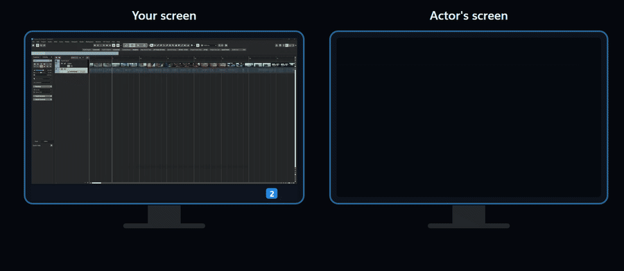

# FrameBridge — natives Video & externe Untertitel für Cubase & Nuendo

[English](../README.md) · **Deutsch** · [Français](README.fr.md) · [Español](README.es.md) · [Italiano](README.it.md) · [Português (Brasil)](README.pt-br.md) · [Polski](README.pl.md) · [Türkçe](README.tr.md) · [Русский](README.ru.md) · [Українська](README.uk.md) · [日本語](README.ja.md) · [简体中文](README.zh.md) · [한국어](README.ko.md)

    

Oben eine kurze Videoanleitung in Cubase 11 Pro: eine MKV mit ihrer SRT-Untertiteldatei und eine HDR-MKV, die in SDR angezeigt wird. [Erweiterte Version auf YouTube](https://youtu.be/NjNHtkc8-OE): ein ungeschnittener Durchgang, live importiert – MKV (HEVC 4K 10 Bit, auch HDR), OGV (Theora), MXF (DNxHR 4K), MOV (ProRes 4444 4K) und mehrere Untertitelformate. Ohne FrameBridge öffnet Cubase MKV und OGV nicht und übernimmt aus MXF nur den Ton.

**[Website](https://framebridge.cc/de/)** · **[Kaufen](https://www.creem.io/payment/prod_vhrQNgibUBvDcUt13M0f1)**

FrameBridge erweitert die native Video-Engine von Cubase und Nuendo unter Windows x64. Moderne Videoformate öffnen sich auf der nativen Videospur und laufen im integrierten Video-Player, und externe Untertiteldateien werden automatisch über dem Bild angezeigt — ohne Transcodierung des Materials und ohne Einbrennen der Untertitel ins Video.

**Cubase oder Nuendo meldet „Datei ist entweder fehlerhaft oder Medientyp wird nicht unterstützt!“?** Genau für diese Meldung ist FrameBridge gemacht. Cubase und Nuendo zeigen sie, wenn die integrierte Video-Engine mit Container, Codec oder Bildrate der Datei nicht zurechtkommt – MKV, WebM, MXF, HEVC von Smartphones wie dem iPhone, Video mit variabler Bildrate. FrameBridge liest solche Dateien mit einem eigenen Decoder. Öffnet sich Ihre Datei trotzdem nicht, erhalten Sie innerhalb von 14 Tagen den vollen Kaufpreis zurück.

## Die wichtigsten Vorteile

- **Moderne Formate auf der nativen Videospur** – MKV, WebM, MXF, HEVC, AV1, ProRes 4444 und viele mehr laufen im integrierten Video-Player, ohne Transkodierung.
- **Externe Untertitel über dem Bild** – `film.srt` neben `film.mkv` legen; Änderungen an der Untertiteldatei erscheinen sofort. Die Videodatei wird nie verändert.
- **Für die Synchronisation gemacht** – ein zweites Videofenster für den Toningenieur, Untertitel direkt aus Synchronbüchern mit Rollen.
- **Kein Plug-in** – kein Plug-in-Slot, nichts in jedem Projekt zu laden, keine MTC-Synchronisation, kein Codec-Pack. Exakte Wiederherstellung mit UNINSTALL.cmd.

Alle Funktionen

- Arbeitet mit der nativen Videospur und dem integrierten Video-Player von Cubase/Nuendo.
- Erweiterte Container- und Codec-Unterstützung durch mitgelieferte FFmpeg-Bibliotheken (LGPL).
- Externe Untertiteldateien werden automatisch geladen und über dem Bild angezeigt; Änderungen an der Untertiteldatei werden live übernommen – auch eine Datei, die erst nach dem Import hinzugefügt oder umbenannt wird, ohne erneuten Import. Die Videodatei selbst wird nie verändert.
- Jedes Untertitelformat wird in einem einheitlichen Look dargestellt (dem SRT-Look). Blu-ray-PGS/SUP- und DVD-VobSub-Bilder werden mit der in Windows integrierten Texterkennung (OCR) als Text gelesen.
- Zweites Videofenster für die Synchronisation: eine Live-Kopie des Video-Players von Cubase/Nuendo für den Toningenieur, während der Sprecher den Player im Vollbild auf einem anderen Bildschirm sieht.
- Untertitel direkt aus Synchronbüchern und Dialoglisten mit Rollen: PDF, DOCX, TXT, XLSX, CSV.
- Kein separater Videoplayer, kein Codec-Pack und keine LAV Filters nötig.
- Kein VST-Plug-in: kein Plug-in-Slot, nichts in jedem Projekt zu laden, keine MTC-Synchronisation – FrameBridge erweitert die native Video-Engine selbst.
- Der Ton kommt über das normale „Audio aus Videodatei extrahieren“ – auch aus MKV und anderen Dateien, die Cubase und Nuendo allein nicht öffnen.
- Visuell geprüfte HDR-zu-SDR-Umwandlung für unterstütztes HDR-Material. Eine messtechnische Aussage zur Farbgenauigkeit wird nicht getroffen.

## Zweites Videofenster für die Synchronisation

Zwei Bildschirme: der Video-Player von Cubase/Nuendo im Vollbild für den Sprecher, die FrameBridge-Kopie für Sie.

## Unterstützte Versionen von Cubase und Nuendo

| | Geprüfte Versionen |
|---|---|
| **Cubase** | 8.0.10 und 9.0.0 (LE AI Elements), 10.5.0.68, 11, 12.0.10 / 12.0.51 / 12.0.52, 13.0.21, 14.0.5 / 14.0.10 / 14.0.20 / 14.0.32 / 14.0.40, 15.0.5 / 15.0.21 / 15.0.30, 16.0.5 |
| **Nuendo** | 10, 12.0.52, 13.0.10 / 13.0.50, 14.0.32 / 14.0.40, 15.0.21 / 15.0.30 |

Die Editionen Cubase Pro, Artist, Elements, AI und LE werden auf dieselbe Weise erkannt. Die vollständige Matrix steht in [COMPATIBILITY.txt](../docs/COMPATIBILITY.txt) (Englisch). Thumbnails auf der Videospur gibt es in allen geprüften Versionen.

Andere Versionen und Updates

**Benachbarte Versionen funktionieren sehr wahrscheinlich.** Die Video-Engine ändert sich innerhalb einer Produktgeneration kaum: Ist zum Beispiel Nuendo 12.0.52 geprüft, funktionieren 12.0.20 oder 12.0.70 sehr wahrscheinlich ebenfalls. Das Installationsprogramm prüft die Video-Engine jeder Installation selbst: Eine kompatible wird zur Installation angeboten, eine inkompatible erscheint nicht in der Liste, und nichts wird verändert. Ältere Editionen mit derselben Engine-Generation (zum Beispiel Nuendo 7–9, Cubase 8.5 / 9.5) können ebenfalls infrage kommen, wurden aber nicht getestet.

**Funktioniert es nach einem Update von Cubase oder Nuendo?** FrameBridge ist mit den oben aufgeführten Versionen geprüft, bis Cubase 16.0.5 und Nuendo 15.0.30. Eine neue Hauptversion kann die Video-Engine ändern – dann bietet das Installationsprogramm diese Installation einfach nicht an und ändert nichts. Nach einem Update von Cubase oder Nuendo führen Sie einfach erneut INSTALL.cmd aus. Funktioniert FrameBridge nach dem Update Ihres Cubase oder Nuendo nicht mehr, schreiben Sie dem Support.

## Geprüfte Medienunterstützung

**Container:** MKV / WebM, MOV / MP4, MXF, M2TS / MTS / TS, AVI, MPEG-PS / VOB, WMV und weitere.

**Videocodecs:** H.264 (inkl. High10, B-Frames, VFR), HEVC Main / Main10, AV1 8/10-Bit, VP9, ProRes 422 HQ / 4444 / LT / Proxy, DNxHD / DNxHR, CineForm, XDCAM, XAVC / AVC-Intra, MPEG-2, APV, FFV1 und weitere.

**Externe Untertitel:** SRT, ASS, SSA, VTT, SMI / SAMI, MicroDVD, TTML, DFXP, IMSC, EBU STL, SCC, DCP XML, PGS / SUP und VobSub (das Paar .idx + .sub). Legen Sie die Untertiteldatei mit gleichem Namen neben das Video (zum Beispiel `film.mkv` + `film.srt`).

Getestet mit schwerem echtem Material: ein 4K-HDR-Blu-ray-Remux (HEVC, ~25 GB) in einem Projekt mit 8 Dialogspuren und vielen Plug-ins und eine 4K-HEVC-Streaming-Folge (~7 GB) – flüssige Wiedergabe und flüssiges Spulen.

Alle geprüften Container und Codecs

**Container:** MKV / WebM, MK3D, FLV, F4V, M2TS / MTS / TS, TOD, MOD, EVO, DV, MOV / MP4, M4V, AVI, DivX, MXF, MPEG-PS / VOB, WMV / ASF, WTV / DVR-MS, 3GP / 3G2, RM / RMVB, OGM und OGV.

**Videocodecs und Profile:** APV, AV1 8-Bit, AV1 10-Bit, CineForm, DNxHR, FFV1, H.264 Main / High10 / B-Frames / VFR, HEVC Main / Main10, HuffYUV, HAP / HAP Q, MPEG-1, DV, MPEG-2, ProRes 422 HQ, ProRes 4444, ProRes Proxy, ProRes LT, Theora, UtVideo, VP8, VP9 10-Bit, WMV 7 / 8, DNxHD, XDCAM, XAVC / AVC-Intra, DVCPRO HD, DVCPRO50, Avid 1:1, SpeedHQ, Uncompressed v210, QuickTime Animation, PNG, TIFF, MagicYUV, FFVHuff, DivX / MS MPEG-4, H.263, VP9 8-Bit, Sorenson Spark, RealVideo, Cinepak, Sorenson Video, Microsoft Video 1, Canopus HQ, Canopus HQX und Xvid.

Die Texterkennung von PGS/SUP und VobSub nutzt die in Windows installierten OCR-Sprachen (meist die Systemsprache und Englisch; weitere lassen sich in den Windows-Einstellungen hinzufügen). Fehlt die benötigte Sprache, werden die ursprünglichen Untertitelbilder angezeigt.

Läuft wahrscheinlich auch

**Videocodecs:** HEVC 4:2:2 / 4:4:4, JPEG 2000, Lagarith, Canopus Lossless, Avid Meridian, NotchLC, SheerVideo, Apple Intermediate, Uncompressed r210 / R10k / 2vuy, WMV 9, VC-1, VP6, TechSmith / Camtasia, Fraps, CamStudio, Indeo, VVC / H.266

Dekodiert vom selben FFmpeg 9.0.2 in FrameBridge. Diese Formate öffnen sich meist und laufen oft auch flüssig; auf flüssige Wiedergabe und flüssiges Spulen geprüft sind jedoch nur die Formate oben. Es gilt die Rückerstattung innerhalb von 14 Tagen.

## Leistung

Die Wiedergabegeschwindigkeit hängt vom Material und von der Hardware ab. Für die tägliche Arbeit sollten Sie mit einer aktuellen Mittelklasse-CPU und einer Grafikkarte rechnen, die die verwendeten Formate (HEVC, AV1) in Hardware dekodiert. Auf älteren PCs – etwa einem Test-PC von 2012 (Intel Core i5-2550K + GeForce GTX 660) – ruckelt schweres 4K-10-Bit-Video (HEVC Main10, H.264 High10), weil eine GPU dieser Generation diese Formate nicht in Hardware dekodieren kann. Auf schwachen PCs hilft es, die Video-Thumbnails in der DAW auszuschalten und mit H.264-8-Bit-Arbeitskopien bis 1080p zu arbeiten. Bekannte Probleme stehen in [READ_ME_FIRST.txt](../docs/READ_ME_FIRST.txt).

## Installation und Wiederherstellung

- Cubase und Nuendo schließen und `INSTALL.cmd` ausführen. Registrierte Installationen werden automatisch gefunden; andernfalls die EXE-Datei oder den Programmordner auswählen.
- `UNINSTALL.cmd` stellt die originalen Programmdateien aus einer geprüften Sicherung wieder her (Byte für Byte). Projekte, Einstellungen und Plug-ins bleiben unberührt.
- Im Paket wird keine Steinberg-Datei mitgeliefert; das Installationsprogramm arbeitet nur mit den Dateien Ihrer eigenen Installation.

Die vollständige Anleitung steht in [READ_ME_FIRST.txt](../docs/READ_ME_FIRST.txt) und [README.txt](../docs/README.txt) (Englisch).

## Prüfung der Release-Datei

- Aktuelles Release: `FrameBridge Native Video and Subtitles for Cubase and Nuendo Beta v2.zip`
- SHA-256: `714df321641fb5c947244c9b3e55c72e5551bdb2c4b6d546b2cf6afc95931abc`
- [VirusTotal-Bericht](https://www.virustotal.com/gui/file/714df321641fb5c947244c9b3e55c72e5551bdb2c4b6d546b2cf6afc95931abc/detection) (Stand 14. November 2026): 0/61 — kein Scanner meldet etwas, darunter Microsoft Defender, ESET, Malwarebytes, Sophos und Symantec.
- Was das Installationsprogramm auf Ihrem PC ändert und wie Sie es selbst prüfen: [SECURITY.md](../SECURITY.md)

## Wer FrameBridge entwickelt

Ich bin stark622, Toningenieur für Synchronisation und Voice-over und Entwickler von FrameBridge. Ich habe es für meine eigene Arbeit gebaut: Videos von Kunden kommen oft in Formaten, die Cubase nicht öffnet, die Untertitel als separate Dateien – und jede Lieferung zu konvertieren oder Untertitel ins Bild einzubrennen kostet Zeit. Fragen und Feedback landen direkt bei mir: stark622@ukr.net.

Auch auf: [KVR Audio](https://www.kvraudio.com/news/framebridge-brings-modern-video-formats-and-external-subtitles-to-the-native-cubase-and-nuendo-video-player-69505) · [Gearspace](https://gearspace.com/threads/framebridge-beta-released-native-video-formats-and-external-subtitles-in-cubase-nuendo.1470656/) · [Noizefield](https://www.noizefield.com/news/framebridge-beta-extends-cubase-nuendo-video-engine)

## Plattform und Status

- Windows x64
- FrameBridge Beta 2 · veröffentlicht am 14. November 2026
- Kommerzielle, proprietäre Software

**[FrameBridge kaufen](https://www.creem.io/payment/prod_vhrQNgibUBvDcUt13M0f1)** · Website: [framebridge.cc](https://framebridge.cc/de/)

**Preis:** Preis frei wählbar: US$29 bis US$59 · die Kasse öffnet mit 59, Sie können auf 29 senken · Einmalkauf

Schreiben Sie innerhalb von 14 Tagen nach dem Kauf an stark622@ukr.net. Lässt sich FrameBridge mit Ihrem Cubase oder Nuendo nicht installieren oder funktioniert es nicht, erhalten Sie den vollen Kaufpreis zurück.

**Support:** stark622@ukr.net

**Rechtliches (Englisch; maßgeblich ist die englische Fassung):**

- [Datenschutzerklärung](../docs/PRIVACY_POLICY.md)
- [Nutzungsbedingungen](../docs/TERMS_OF_SERVICE.md)
- [Endbenutzerlizenz](../docs/END_USER_LICENSE.txt)

## Lizenzierung

FrameBridge ist kommerzielle Software. Die Bedingungen für das proprietäre Produkt stehen in [END_USER_LICENSE.txt](../docs/END_USER_LICENSE.txt). Angaben zur Lizenzierung von Drittkomponenten, einschließlich der Bedingungen für die mitgelieferten FFmpeg-Bibliotheken (LGPL 2.1 oder später, Quellcode im Paket enthalten), stehen in [LICENSE_AND_NOTICE.txt](../LICENSE_AND_NOTICE.txt).

FrameBridge ist unabhängige Software und steht in keiner Verbindung zu Steinberg, wird von Steinberg weder gesponsert noch unterstützt. Cubase und Nuendo sind Marken ihres jeweiligen Inhabers.
