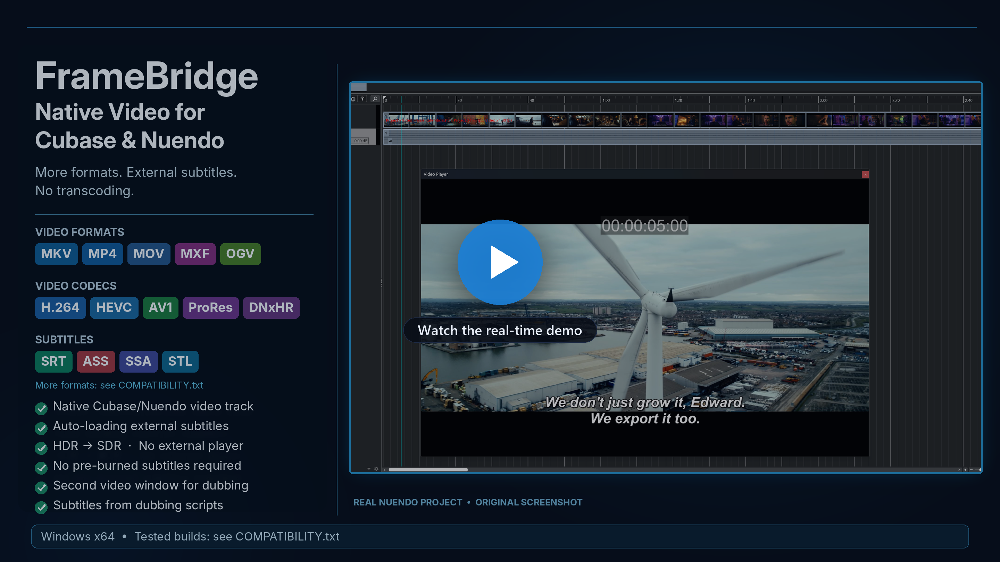

# FrameBridge — Cubase & Nuendo를 위한 네이티브 비디오와 외부 자막

[English](../README.md) · [Deutsch](README.de.md) · [Français](README.fr.md) · [Español](README.es.md) · [Italiano](README.it.md) · [Português (Brasil)](README.pt-br.md) · [Polski](README.pl.md) · [Türkçe](README.tr.md) · [Русский](README.ru.md) · [Українська](README.uk.md) · [日本語](README.ja.md) · [简体中文](README.zh.md) · **한국어**

**웹사이트: [framebridge.cc](https://framebridge.cc/ko/)** · [YouTube에서 FrameBridge 데모 보기](https://youtu.be/qJqN0ybHV8E)

FrameBridge는 Windows x64용 Cubase와 Nuendo의 네이티브 비디오 엔진을 확장합니다. 최신 비디오 포맷이 기본 비디오 트랙에서 열리고 내장 비디오 플레이어에서 재생되며, 외부 자막 파일은 화면 위에 자동으로 표시됩니다. 소스를 트랜스코딩할 필요도, 자막을 영상에 입힐 필요도 없습니다.

## 주요 장점

- Cubase/Nuendo 기본 비디오 트랙과 내장 비디오 플레이어에서 작동합니다.
- 함께 제공되는 FFmpeg 라이브러리(LGPL)로 컨테이너와 코덱 지원을 확장합니다.
- 외부 자막 파일을 자동으로 불러와 화면 위에 표시하며, 자막 파일을 수정하면 바로 반영됩니다. 비디오 파일 자체는 절대 변경되지 않습니다.
- 모든 자막 포맷이 하나의 모양(SRT와 같은 모양)으로 표시됩니다. 블루레이 PGS/SUP와 DVD VobSub 이미지 자막은 Windows 내장 OCR로 텍스트로 읽어 들입니다.
- 별도의 비디오 플레이어, 코덱 팩, LAV Filters가 필요 없습니다.
- VST 플러그인이 아닙니다. 프로젝트에 따로 불러올 것이 없으며, FrameBridge가 기본 비디오 엔진 자체를 확장합니다.
- 지원되는 HDR 소스의 HDR→SDR 변환을 육안으로 검증했습니다. 색 정확도에 대한 정량적 보증은 하지 않습니다.

## 지원되는 Cubase 및 Nuendo 버전

**검증된 버전**

- **Cubase:** 8.0.10 및 9.0.0(LE AI Elements), 10.5.0.68, 11, 12.0.10 / 12.0.51 / 12.0.52, 13.0.21, 14.0.5 / 14.0.10 / 14.0.20 / 14.0.32 / 14.0.40, 15.0.5 / 15.0.21 / 15.0.30
- **Nuendo:** 10, 12.0.52, 13.0.10 / 13.0.50, 14.0.32 / 14.0.40, 15.0.21 / 15.0.30

**인접 버전도 작동할 가능성이 매우 높습니다.** 비디오 엔진은 같은 제품 세대 안에서는 거의 바뀌지 않습니다. 예를 들어 Nuendo 12.0.52가 검증되었다면 12.0.20이나 12.0.70도 작동할 가능성이 매우 높습니다. 설치 프로그램이 각 설치의 비디오 엔진을 직접 확인하여, 호환되는 설치는 설치 대상으로 표시하고 호환되지 않는 설치는 목록에 표시하지 않으며 아무것도 변경하지 않습니다. 작동을 보장하는 것은 아닙니다. 같은 엔진 세대의 이전 에디션(예: Nuendo 7–9, Cubase 8.5 / 9.5)도 해당될 수 있지만 테스트하지는 않았습니다.

Cubase 8과 9에서는 FrameBridge가 여는 파일(예: MKV)의 오디오도 제공하므로, "Extract Audio From Video"를 최신 버전과 똑같이 사용할 수 있습니다.

Cubase Pro, Artist, Elements, AI, LE 에디션도 같은 방식으로 인식됩니다. 전체 목록은 [COMPATIBILITY.txt](../COMPATIBILITY.txt)(영문)를 참고하세요.

**Cubase나 Nuendo를 업데이트해도 작동하나요?** FrameBridge는 위에 나열된 빌드(Cubase 및 Nuendo 15.0.30까지)에서 검증되었으며, 버전 15 전체에서 작동하도록 만들어졌습니다. 설치 프로그램이 각 설치의 비디오 엔진을 직접 확인합니다. 버전 15 안에서 업데이트한 후 FrameBridge가 작동하지 않으면 INSTALL.cmd를 다시 실행하세요. 업데이트로 프로그램 파일이 교체되었을 수 있습니다. Cubase 또는 Nuendo 16 같은 새 메이저 버전은 비디오 엔진이 바뀔 수 있으며 이번 베타의 지원 대상이 아닙니다.

## 검증된 미디어

**컨테이너:** MKV / WebM, FLV, M2TS / MTS / TS, MOV / MP4, AVI, MXF, MPEG-PS / VOB, OGV

**비디오 코덱 및 프로파일:** APV, AV1 8비트, AV1 10비트, CineForm, DNxHR, FFV1, H.264 Main / High10 / B-프레임 / VFR, HEVC Main10, HuffYUV, MPEG-2, ProRes 422 HQ, ProRes 4444, Theora, UtVideo, VP8, VP9 10비트, Xvid

**외부 자막:** SRT, ASS, SSA, VTT, SMI / SAMI, MicroDVD, TTML, DFXP, IMSC, EBU STL, SCC, DCP XML, PGS / SUP, VobSub(.idx + .sub 한 쌍). 자막 파일을 비디오와 같은 이름으로 같은 폴더에 두세요(예: `film.mkv` + `film.srt`).

PGS/SUP와 VobSub의 텍스트 인식에는 Windows에 설치된 OCR 언어가 사용됩니다(보통 시스템 언어와 영어이며, Windows 설정에서 다른 언어를 추가할 수 있습니다). 필요한 언어가 없으면 원래의 자막 이미지가 표시됩니다.

VVC/H.266은 이번 베타에서 의도적으로 지원하지 않습니다.

**Cubase나 Nuendo에서 “Invalid or not supported file!”이라고 나옵니다. FrameBridge로 열 수 있나요?** 대부분 가능합니다. 이 메시지는 기본 비디오 엔진이 파일의 컨테이너나 코덱을 읽지 못할 때 표시됩니다. 예를 들어 MKV, WebM, MXF, iPhone 같은 스마트폰으로 촬영한 HEVC, 가변 프레임 레이트 비디오 등입니다. FrameBridge는 자체 디코더로 이러한 파일을 읽습니다. 검증된 포맷은 위에 나와 있습니다. 그래도 파일이 열리지 않으면 14일 이내에 전액 환불해 드립니다.

## 설치 및 복원

- Cubase와 Nuendo를 닫고 `INSTALL.cmd`를 실행하세요. 등록된 설치는 자동으로 찾아지며, 찾지 못하면 프로그램의 EXE 파일이나 폴더를 선택하면 됩니다.
- `UNINSTALL.cmd`는 검증된 백업에서 프로그램 원본 파일을 복원합니다(바이트 단위까지 그대로). 프로젝트, 환경 설정, 플러그인은 건드리지 않습니다.
- 패키지에는 Steinberg 파일이 전혀 포함되어 있지 않으며, 설치 프로그램은 사용자의 설치 파일만 다룹니다.

자세한 안내는 [READ_ME_FIRST.txt](../READ_ME_FIRST.txt)와 [README.txt](../README.txt)(영문)를 참고하세요.

## 릴리스 파일 확인

- 현재 릴리스: `FrameBridge Native Video and Subtitles for Cubase and Nuendo Beta.zip`
- SHA-256: `c804d914c86e2abe7f05476455ae8efb447c6f2a74220bef515af9d266709e50`
- [VirusTotal 보고서](https://www.virustotal.com/gui/file/c804d914c86e2abe7f05476455ae8efb447c6f2a74220bef515af9d266709e50/detection)(2026년 10월 31일 기준): 1/63 — 엔진 하나(MaxSecure)의 일반적인 휴리스틱 탐지 1건뿐입니다. Microsoft Defender, Kaspersky, BitDefender, ESET, Malwarebytes, Sophos, Symantec 등 검사를 마친 나머지 엔진에서는 아무것도 탐지되지 않았습니다.

## 성능

재생 속도는 소스와 하드웨어에 따라 달라집니다. 무거운 4K 10비트 영상(HEVC Main10, H.264 High10)에는 충분한 성능의 CPU/GPU가 필요합니다. 오래된 테스트 PC(Intel Core i5-2550K + GeForce GTX 660)에서는 해당 세대의 GPU가 이 포맷을 하드웨어로 디코딩하지 못해 심하게 끊겼습니다. 성능이 낮은 PC에서는 DAW에서 비디오 썸네일을 끄고 1080p 이하의 H.264 8비트 작업용 사본을 사용하는 것을 권장합니다. 알려진 문제는 [READ_ME_FIRST.txt](../READ_ME_FIRST.txt)에 정리되어 있습니다.

## FrameBridge를 만든 사람

더빙·보이스오버 엔지니어이자 FrameBridge 개발자인 Roman Aksonov입니다. 제 작업을 위해 만들었습니다. 클라이언트가 보내는 비디오는 Cubase에서 열리지 않는 포맷인 경우가 많고, 자막은 별도 파일로 옵니다. 납품할 때마다 변환하거나 자막을 화면에 입히는 데 시간이 듭니다. 질문과 의견은 저에게 바로 전달됩니다: stark622@ukr.net.

함께 보기: [KVR Audio](https://www.kvraudio.com/news/framebridge-brings-modern-video-formats-and-external-subtitles-to-the-native-cubase-and-nuendo-video-player-69505) · [Gearspace](https://gearspace.com/threads/framebridge-beta-released-native-video-formats-and-external-subtitles-in-cubase-nuendo.1470656/) · [Noizefield](https://www.noizefield.com/news/framebridge-beta-extends-cubase-nuendo-video-engine)

## 플랫폼 및 상태

- Windows x64
- FrameBridge Beta 1 · 2026년 10월 29일 출시
- 상용 독점 소프트웨어

**[FrameBridge 구매](https://www.creem.io/payment/prod_vhrQNgibUBvDcUt13M0f1)** · 웹사이트: [framebridge.cc](https://framebridge.cc/ko/)

**가격:** 원하는 금액으로 결제 — 최소 29 USD, 권장 59 USD. 1회 구매입니다.

구매 후 14일 이내에 stark622@ukr.net로 메일을 보내 주세요. FrameBridge가 사용 중인 Cubase 또는 Nuendo에 설치되지 않거나 작동하지 않으면 전액 환불해 드립니다.

**지원:** stark622@ukr.net

**법률 문서(영문, 영문판이 우선합니다):**

- [개인정보 처리방침](../PRIVACY_POLICY.md)
- [서비스 약관](../TERMS_OF_SERVICE.md)
- [최종 사용자 라이선스](../END_USER_LICENSE.txt)

## 라이선스

FrameBridge는 상용 소프트웨어입니다. 제품 이용 조건은 [END_USER_LICENSE.txt](../END_USER_LICENSE.txt)에 있습니다. 함께 제공되는 FFmpeg 공유 라이브러리(LGPL 2.1 이상, 소스 코드는 패키지에 포함)에 적용되는 조건을 비롯한 타사 라이선스 정보는 [LICENSE_AND_NOTICE.txt](../LICENSE_AND_NOTICE.txt)에 있습니다.

FrameBridge는 독립 소프트웨어이며 Steinberg와 제휴 관계가 없고, Steinberg의 후원이나 승인을 받지 않았습니다. Cubase와 Nuendo는 각 소유자의 상표입니다.
