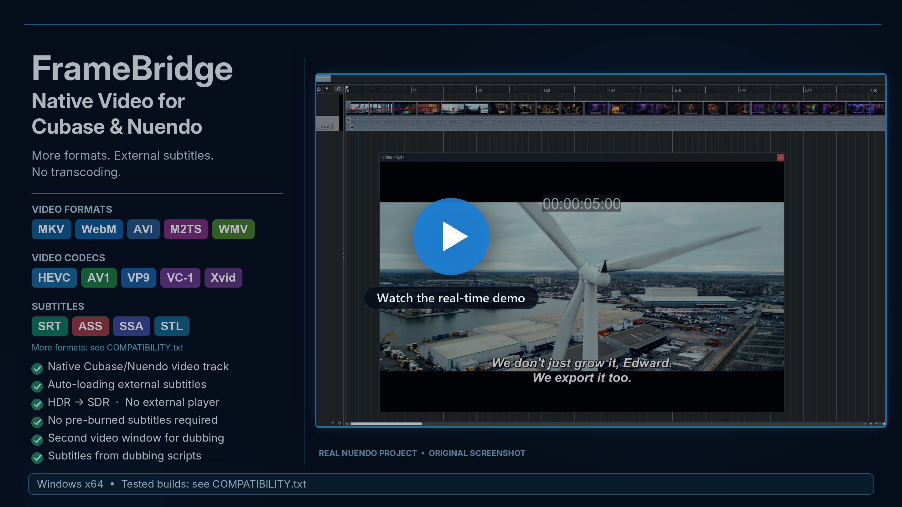

# FrameBridge — Cubase ve Nuendo için yerel video ve harici altyazılar

[English](../README.md) · [Deutsch](README.de.md) · [Français](README.fr.md) · [Español](README.es.md) · [Italiano](README.it.md) · [Português (Brasil)](README.pt-br.md) · [Polski](README.pl.md) · **Türkçe** · [Русский](README.ru.md) · [Українська](README.uk.md) · [日本語](README.ja.md) · [简体中文](README.zh.md) · [한국어](README.ko.md)

    

Yukarıda Cubase 11 Pro’da kısa bir video rehberi var: SRT altyazı dosyasıyla birlikte bir MKV ve SDR olarak gösterilen bir HDR MKV. [YouTube’daki uzun sürüm](https://youtu.be/NjNHtkc8-OE): tek bir kesintisiz çekim, canlı içe aktarma — MKV (HEVC 4K 10-bit, HDR dahil), OGV (Theora), MXF (DNxHR 4K), MOV (ProRes 4444 4K) ve birkaç altyazı formatı. FrameBridge olmadan Cubase MKV ve OGV’yi açmaz, MXF’ten ise yalnızca sesi alır.

**[Web sitesi](https://framebridge.cc/tr/)** · **[Satın al](https://www.creem.io/payment/prod_vhrQNgibUBvDcUt13M0f1)**

FrameBridge, Windows x64’teki Cubase ve Nuendo’nun yerel video motorunu genişletir. Modern video formatları yerel video kanalında (Video Track) açılır ve yerleşik Video Player’da oynatılır; harici altyazı dosyaları ise görüntünün üzerinde otomatik olarak gösterilir — medyayı dönüştürmeden ve altyazıları videoya gömmeden.

**Cubase veya Nuendo “Invalid or not supported file!” mi diyor?** FrameBridge tam da bu mesaj için yapıldı. Cubase ve Nuendo bu mesajı, yerleşik video motoru dosyanın kapsayıcısını, kodeğini veya kare hızını işleyemediğinde gösterir: MKV, WebM, MXF, iPhone gibi telefonlardan gelen HEVC, değişken kare hızlı video. FrameBridge bu dosyaları kendi kod çözücüsüyle okur. Dosyanız yine de açılmazsa 14 gün içinde ücretin tamamı iade edilir.

## Başlıca avantajlar

- **Yerel video kanalında modern formatlar**: MKV, WebM, MXF, HEVC, AV1, ProRes 4444 ve daha birçoğu yerleşik Video Player’da dönüştürme olmadan oynar.
- **Görüntünün üzerinde harici altyazılar**: `film.srt` dosyasını `film.mkv` yanına koyun; altyazı dosyasındaki değişiklikler anında görünür. Video dosyası asla değiştirilmez.
- **Dublaj için yapıldı**: ses mühendisi için ikinci video penceresi, rol bilgili dublaj metinlerinden doğrudan altyazı.
- **Eklenti değildir**: eklenti yuvası yok, her projede bir şey yüklemek yok, MTC senkronu yok, codec paketi yok. UNINSTALL.cmd ile birebir geri alma.

Tüm özellikler

- Cubase/Nuendo’nun yerel video kanalı ve yerleşik Video Player’ı ile çalışır.
- Pakete dahil FFmpeg kütüphaneleri (LGPL) sayesinde genişletilmiş kapsayıcı ve codec desteği.
- Harici altyazı dosyaları otomatik olarak yüklenir ve görüntünün üzerinde gösterilir; altyazı dosyasında yapılan değişiklikler anında yansır — içe aktarmadan sonra eklenen veya yeniden adlandırılan dosya bile, yeniden içe aktarmaya gerek kalmadan. Video dosyasının kendisi asla değiştirilmez.
- Tüm altyazı formatları tek tip bir görünümle (SRT görünümüyle) gösterilir. Blu-ray PGS/SUP ve DVD VobSub görüntüleri, Windows’un yerleşik OCR özelliğiyle metin olarak okunur.
- Dublaj için ikinci video penceresi: oyuncu oynatıcıyı başka bir ekranda tam ekran izlerken ses mühendisi için Cubase/Nuendo Video Player’ın canlı kopyası.
- Rol bilgili dublaj metinlerinden ve diyalog listelerinden doğrudan altyazı: PDF, DOCX, TXT, XLSX, CSV.
- Ayrı bir video oynatıcı, codec paketi veya LAV Filters gerekmez.
- VST eklentisi değildir: eklenti yuvası, her projede bir şey yüklemek ya da MTC senkronu gerekmez; FrameBridge doğrudan yerel video motorunu genişletir.
- Ses, standart “Extract Audio From Video” seçeneğiyle gelir — Cubase ve Nuendo’nun tek başına açamadığı MKV ve diğer dosyalardan da.
- Desteklenen HDR içerikler için görsel olarak doğrulanmış HDR’den SDR’ye dönüştürme. Renk doğruluğuna dair ölçüme dayalı bir iddiada bulunulmaz.

## Dublaj için ikinci video penceresi

İki ekran: oyuncu için tam ekran Cubase/Nuendo Video Player, sizin için FrameBridge kopyası.

## Desteklenen Cubase ve Nuendo sürümleri

| | Doğrulanmış sürümler |
|---|---|
| **Cubase** | 8.0.10 ve 9.0.0 (LE AI Elements), 10.5.0.68, 11, 12.0.10 / 12.0.51 / 12.0.52, 13.0.21, 14.0.5 / 14.0.10 / 14.0.20 / 14.0.32 / 14.0.40, 15.0.5 / 15.0.21 / 15.0.30, 16.0.5 |
| **Nuendo** | 10, 12.0.52, 13.0.10 / 13.0.50, 14.0.32 / 14.0.40, 15.0.21 / 15.0.30 |

Cubase Pro, Artist, Elements, AI ve LE sürümleri de aynı şekilde bulunur. Tam tablo [COMPATIBILITY.txt](../docs/COMPATIBILITY.txt) dosyasındadır (İngilizce). Video kanalındaki küçük resimler tüm doğrulanmış sürümlerde görünür.

Diğer sürümler ve güncellemeler

**Yakın sürümlerin çalışması çok olasıdır.** Video motoru bir ürün kuşağı içinde neredeyse hiç değişmez: örneğin Nuendo 12.0.52 doğrulandıysa, 12.0.20 veya 12.0.70 de büyük olasılıkla çalışır. Yükleyici her kurulumun video motorunu kendisi kontrol eder: uyumlu olan kurulum için önerilir, uyumsuz olan listede yer almaz ve hiçbir şey değiştirilmez. Aynı motor kuşağına sahip daha eski sürümler (örneğin Nuendo 7–9, Cubase 8.5 / 9.5) de uygun olabilir, ancak test edilmemiştir.

**Cubase veya Nuendo güncellemesinden sonra çalışır mı?** FrameBridge, yukarıda listelenen sürümlerle, Cubase 16.0.5 ve Nuendo 15.0.30’a kadar doğrulanmıştır. Yeni bir ana sürüm video motorunu değiştirebilir; bu durumda yükleyici o kurulumu sunmaz ve hiçbir şeyi değiştirmez. Cubase veya Nuendo’yu güncelledikten sonra INSTALL.cmd’yi yeniden çalıştırmanız yeterli. Cubase veya Nuendo’nuzu güncelledikten sonra FrameBridge çalışmayı bırakırsa desteğe yazın.

## Doğrulanmış medya desteği

**Kapsayıcılar:** MKV / WebM, MOV / MP4, MXF, M2TS / MTS / TS, AVI, MPEG-PS / VOB, WMV ve daha fazlası.

**Video codec’leri:** H.264 (High10, B-kareler, VFR dahil), HEVC Main / Main10, AV1 8/10-bit, VP9, ProRes 422 HQ / 4444 / LT / Proxy, DNxHD / DNxHR, CineForm, XDCAM, XAVC / AVC-Intra, MPEG-2, APV, FFV1 ve daha fazlası.

**Harici altyazılar:** SRT, ASS, SSA, VTT, SMI / SAMI, MicroDVD, TTML, DFXP, IMSC, EBU STL, SCC, DCP XML, PGS / SUP ve VobSub (.idx + .sub çifti). Altyazı dosyasını aynı adla videonun yanına koyun (örneğin `film.mkv` + `film.srt`).

Ağır, gerçek materyallerle test edildi: 8 diyalog kanalı ve çok sayıda eklenti içeren bir projede 4K HDR Blu-ray remux (HEVC, ~25 GB) ve 4K HEVC bir yayın bölümü (~7 GB) — akıcı oynatma ve sarma.

Doğrulanmış tüm kapsayıcılar ve codec’ler

**Kapsayıcılar:** MKV / WebM, MK3D, FLV, F4V, M2TS / MTS / TS, TOD, MOD, EVO, DV, MOV / MP4, M4V, AVI, DivX, MXF, MPEG-PS / VOB, WMV / ASF, WTV / DVR-MS, 3GP / 3G2, RM / RMVB, OGM ve OGV.

**Video codec’leri ve profilleri:** APV, AV1 8-bit, AV1 10-bit, CineForm, DNxHR, FFV1, H.264 Main / High10 / B-frames / VFR, HEVC Main / Main10, HuffYUV, HAP / HAP Q, MPEG-1, DV, MPEG-2, ProRes 422 HQ, ProRes 4444, ProRes Proxy, ProRes LT, Theora, UtVideo, VP8, VP9 10-bit, WMV 7 / 8, DNxHD, XDCAM, XAVC / AVC-Intra, DVCPRO HD, DVCPRO50, Avid 1:1, SpeedHQ, Uncompressed v210, QuickTime Animation, PNG, TIFF, MagicYUV, FFVHuff, DivX / MS MPEG-4, H.263, VP9 8-bit, Sorenson Spark, RealVideo, Cinepak, Sorenson Video, Microsoft Video 1, Canopus HQ, Canopus HQX ve Xvid.

PGS/SUP ve VobSub metin tanıma, Windows’ta yüklü OCR dillerini kullanır (genellikle sistem dili ve İngilizce; Windows ayarlarından başka diller eklenebilir). Gerekli dil yoksa altyazıların orijinal görüntüleri gösterilir.

Büyük olasılıkla bunlar da oynar

**Video codec’leri:** HEVC 4:2:2 / 4:4:4, JPEG 2000, Lagarith, Canopus Lossless, Avid Meridian, NotchLC, SheerVideo, Apple Intermediate, Uncompressed r210 / R10k / 2vuy, WMV 9, VC-1, VP6, TechSmith / Camtasia, Fraps, CamStudio, Indeo, VVC / H.266

FrameBridge içindeki aynı FFmpeg 9.0.2 ile çözülür. Bu formatlar genellikle açılır ve akıcı da oynayabilir; ancak akıcı oynatma ve sarma yalnızca yukarıdaki formatlar için doğrulanmıştır. 14 günlük iade geçerlidir.

## Performans

Oynatma akıcılığı materyale ve donanıma bağlıdır. Günlük çalışma için güncel, orta sınıf bir işlemci ve kullandığınız formatları (HEVC, AV1) donanımsal olarak çözebilen bir ekran kartı düşünün. Daha eski bilgisayarlarda — örneğin 2012 tarihli bir test bilgisayarında (Intel Core i5-2550K + GeForce GTX 660) — ağır 4K 10-bit video (HEVC Main10, H.264 High10) takılır, çünkü o neslin GPU’su bu formatları donanımsal olarak çözemez. Zayıf bilgisayarlarda DAW’da video küçük resimlerini kapatmak ve 1080p’ye kadar H.264 8-bit çalışma kopyaları kullanmak yardımcı olur. Bilinen sorunlar [READ_ME_FIRST.txt](../docs/READ_ME_FIRST.txt) dosyasında listelenmiştir.

## Kurulum ve geri alma

- Cubase ve Nuendo’yu kapatın ve `INSTALL.cmd`’yi çalıştırın. Kayıtlı kurulumlar otomatik olarak bulunur; bulunamazsa programın EXE dosyasını veya klasörünü seçin.
- `UNINSTALL.cmd`, programın orijinal dosyalarını doğrulanmış bir yedekten geri yükler (bayt bayt). Projelere, tercihlere ve eklentilere dokunulmaz.
- Pakette hiçbir Steinberg dosyası yoktur; yükleyici yalnızca kendi kurulumunuzdaki dosyalarla çalışır.

Ayrıntılı talimatlar [READ_ME_FIRST.txt](../docs/READ_ME_FIRST.txt) ve [README.txt](../docs/README.txt) dosyalarındadır (İngilizce).

## Sürüm dosyası kontrolü

- Güncel sürüm: `FrameBridge Native Video and Subtitles for Cubase and Nuendo Beta v2.zip`
- SHA-256: `714df321641fb5c947244c9b3e55c72e5551bdb2c4b6d546b2cf6afc95931abc`
- [VirusTotal raporu](https://www.virustotal.com/gui/file/714df321641fb5c947244c9b3e55c72e5551bdb2c4b6d546b2cf6afc95931abc/detection) (14 Kasım 2026 itibarıyla): 0/61 — Microsoft Defender, ESET, Malwarebytes, Sophos ve Symantec dahil hiçbir motor bir şey bulmadı.
- Yükleyicinin bilgisayarınızda neyi değiştirdiği ve bunu kendiniz nasıl kontrol edeceğiniz: [SECURITY.md](../SECURITY.md)

## FrameBridge’i kim geliştiriyor

Ben stark622; dublaj ve seslendirme mühendisiyim, FrameBridge’in de geliştiricisiyim. Onu kendi işim için yaptım: müşterilerden gelen videolar çoğu zaman Cubase’in açmadığı formatlarda, altyazılar ise ayrı dosyalar halinde geliyor; her teslimatı dönüştürmek ya da altyazıyı görüntüye gömmek zaman kaybettiriyor. Sorular ve geri bildirimler doğrudan bana ulaşır: stark622@ukr.net.

Ayrıca: [KVR Audio](https://www.kvraudio.com/news/framebridge-brings-modern-video-formats-and-external-subtitles-to-the-native-cubase-and-nuendo-video-player-69505) · [Gearspace](https://gearspace.com/threads/framebridge-beta-released-native-video-formats-and-external-subtitles-in-cubase-nuendo.1470656/) · [Noizefield](https://www.noizefield.com/news/framebridge-beta-extends-cubase-nuendo-video-engine)

## Platform ve durum

- Windows x64
- FrameBridge Beta 2 · 14 Kasım 2026’da yayımlandı
- Ticari, kapalı kaynak yazılım

**[FrameBridge’i satın al](https://www.creem.io/payment/prod_vhrQNgibUBvDcUt13M0f1)** · Web sitesi: [framebridge.cc](https://framebridge.cc/tr/)

**Fiyat:** Dilediğiniz fiyat: 29–59 USD · ödeme sayfası 59 ile açılır, 29’a kadar düşürebilirsiniz · tek seferlik satın alma

Satın aldıktan sonraki 14 gün içinde stark622@ukr.net adresine yazın. FrameBridge, Cubase veya Nuendo kurulumunuza yüklenmez ya da çalışmazsa ödediğiniz tutarın tamamı iade edilir.

**Destek:** stark622@ukr.net

**Yasal belgeler (İngilizce; İngilizce sürüm esas alınır):**

- [Gizlilik Politikası](../docs/PRIVACY_POLICY.md)
- [Hizmet Şartları](../docs/TERMS_OF_SERVICE.md)
- [Son Kullanıcı Lisansı](../docs/END_USER_LICENSE.txt)

## Lisanslama

FrameBridge ticari bir yazılımdır. Ürüne ait koşullar [END_USER_LICENSE.txt](../docs/END_USER_LICENSE.txt) dosyasındadır. Pakete dahil FFmpeg paylaşımlı kütüphanelerine (LGPL 2.1 veya üstü, kaynak kodu pakette) uygulanan koşullar dahil olmak üzere üçüncü taraf lisans bilgileri [LICENSE_AND_NOTICE.txt](../LICENSE_AND_NOTICE.txt) dosyasındadır.

FrameBridge bağımsız bir yazılımdır; Steinberg ile bağlantılı değildir, Steinberg tarafından desteklenmez veya onaylanmaz. Cubase ve Nuendo, ilgili sahibinin ticari markalarıdır.
